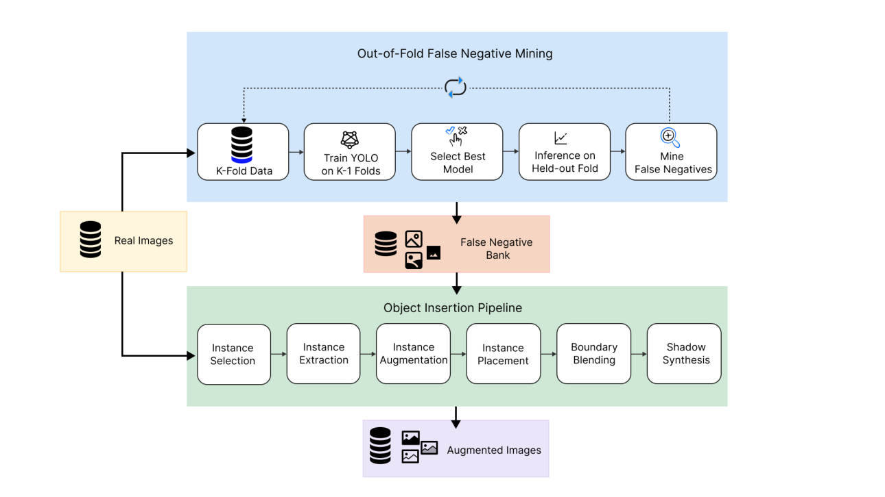
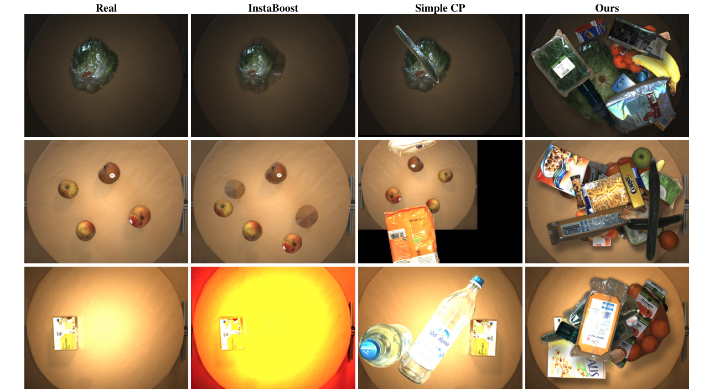
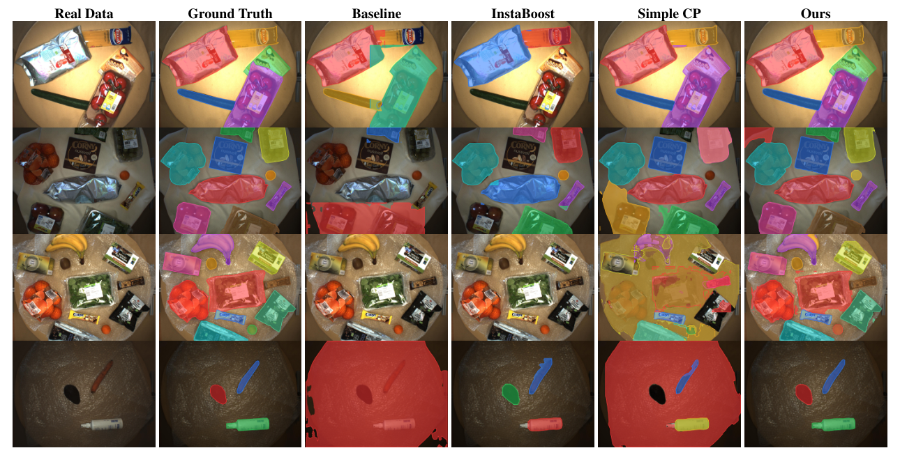

# Failure-Aware Copy-Paste Augmentation for Instance Segmentation

## Overview

Instance segmentation models can fail to detect, classify, or accurately localize annotated objects. This work investigates **failure-aware copy-paste augmentation**, an **offline** data augmentation framework that reuses false-negative (FN) instances to generate new training scenes. Out-of-fold predictions are used to identify challenging ground-truth instances and construct an FN bank. These instances are then combined with randomly sampled annotated objects during copy-paste augmentation.

The augmentation pipeline combines object extraction and placement with **ring-based boundary blending** and **contact/cast shadow synthesis**. Experiments cover **MVTec D2S** and **ARMBench**, using **YOLOv8s-seg, YOLO11s-seg, YOLO26s-seg, Mask R-CNN, and Cascade Mask R-CNN**.

## Method



*Figure 1 from the accompanying manuscript. A five-fold out-of-fold mining stage creates an FN bank; subsequently, the object insertion pipeline uses ordinary and FN objects to produce augmented training images.*

1. **Out-of-fold mining.** Divide training images into five folds, keeping related MVTec scenes together. Train YOLO11s-seg on four folds and infer on the held-out fold.
2. **Failure identification.** Select each fold's confidence threshold by the highest F1 score. Match predictions to ground truth using class-aware one-to-one matching and mask IoU ≥ 0.5. Unmatched ground-truth instances enter the FN bank with their original images, labels, and masks.
3. **Offline synthesis.** Sample ordinary objects and, when enabled, additional FN instances. Transform and place objects onto real training images, update annotations after occlusion, blend insertion boundaries, and synthesize shadows.
4. **Downstream evaluation.** Train instance segmentation models on the generated datasets and evaluate with COCO-style box and mask AP.

## Qualitative examples

### Copy-paste augmentation



*Figure 2 from the manuscript. Columns compare real images, InstaBoost, Simple Copy-Paste, and the proposed augmentation under three lighting conditions. These are illustrations from the paper, not a claim that the repository generates identical samples without the original data and seed settings.*

### Instance segmentation predictions



*Figure 3 from the manuscript. Qualitative YOLO11s-seg results compare models trained on real data, InstaBoost, Simple Copy-Paste, and the proposed augmented dataset against ground truth.*

## Main findings

On **MVTec D2S**, the failure-aware copy-paste pipeline improved Mask AP compared with training on real data, InstaBoost, and Simple Copy-Paste across the five evaluated instance segmentation architectures. In the controlled instance-selection experiment, replacing random non-FN objects with mined FN objects increased Mask AP by **1.59–3.97 percentage points**, with insertion counts and augmentation settings held fixed.

On **ARMBench**, improvements from FN insertion were smaller and varied across architectures. The mined FN bank was much smaller than for MVTec D2S, and FN insertion did not consistently improve performance. Quantitative findings are from the **unpublished manuscript** and may change before submission. Full numerical comparisons will be provided with the public manuscript or publication.

## Repository layout

```text
Failure-Aware-Copy-Paste/
├── fn_mining/
│   └── mine_oof_failures.py
├── mvtec_d2s/
│   ├── data_preparation/
│   │   ├── split_dataset.ipynb
│   │   └── labelme2yolo/
│   ├── proposed_method/
│   │   ├── CP/
│   │   └── run.py
│   └── previous_work/
│       ├── simple_CP/
│       └── instaboost/
├── armbench/
│   ├── proposed_method/
│   │   ├── CP/
│   │   └── run.py
│   └── Previous_work/
│       ├── simple_CP/
│       └── instaboost/
├── training/
│   ├── yolo/train.py
│   └── RCNNs/
│       ├── mask_rcnn/train.py
│       ├── cascade_mask_rcnn/train-cascade.py
│       └── data_preparation/
└── figures/    
```

## Installation

The YOLO-based mining, augmentation, and training workflow requires Python, PyTorch, Ultralytics, OpenCV, NumPy, and supporting packages. The paper used **Ultralytics 8.4.50**. Install a compatible PyTorch build for your machine *before* the following commands; consult the official [PyTorch installer](https://pytorch.org/get-started/locally/).

```bash
conda create -n fmcp python=3.10 -y
conda activate fmcp
# Install a compatible PyTorch / torchvision build for your OS and accelerator.
pip install 'ultralytics==8.4.50' opencv-python numpy pandas scipy PyYAML tqdm Pillow scikit-learn labelme pycocotools
```

Ultralytics provides the three downstream YOLO segmentation architectures. No separate YOLO source checkout is required for these scripts. The pretrained models are selected in `training/yolo/train.py` by setting one of:

```python
BASE_MODEL = "yolov8s-seg.pt"  # or "yolo11s-seg.pt" or "yolo26s-seg.pt"
```

The out-of-fold mining model is **YOLO11s-seg**, configured separately in `fn_mining/mine_oof_failures.py`.

**Mask R-CNN and Cascade Mask R-CNN** use **MMDetection 3.3.0**, with MMEngine and a compatible MMCV installation. These may require a separate environment because PyTorch/CUDA/MMCV compatibility is version-sensitive. Follow the [official MMDetection installation instructions](https://mmdetection.readthedocs.io/en/main/get_started.html) before running `training/RCNNs/mask_rcnn/train.py` or `training/RCNNs/cascade_mask_rcnn/train-cascade.py`.

**InstaBoostFast** has its own dependencies. Install them for the corresponding dataset-specific wrappers:

```bash
conda create -n instaboostfast python=3.10 -y
conda activate instaboostfast
cd mvtec_d2s/previous_work/instaboost
pip install -r requirements.txt
# Or install from armbench/Previous_work/instaboost for ARMBench.
```

## Datasets and preparation

Download the datasets from their official distributors and comply with their licenses. Dataset images and annotations are **not included** in this repository.

**Official dataset sources:** [MVTec D2S downloads](https://www.mvtec.com/research-teaching/datasets/mvtec-d2s/downloads) and [ARMBench object segmentation](https://www.armbench.com/segmentation.html).

- **MVTec D2S** ([official downloads](https://www.mvtec.com/research-teaching/datasets/mvtec-d2s/downloads)): The experiments use 4,380 training images and divides the original validation set into 1,800 validation and 1,800 test images. `mvtec_d2s/data_preparation/split_dataset.ipynb` contains the preparation workflow; check its configured paths and confirm the output partition exactly matches the manuscript before publishing. Keep related views of each scene together. Use the same `classes.json` for conversions of every real and augmented split.
- **ARMBench** ([object segmentation dataset](https://www.armbench.com/segmentation.html)): Use the **Same-Object-Transfer-Set** subset. The paper uses the Same-Object-Transfer-Set subset, with 2,320 training, 496 validation, and 507 test images. Preserve these splits and do not sample from validation or test images during copy-paste augmentation.
- **Annotation conversion**: The MVTec COCO-to-LabelMe preparation is adapted from [travishsu’s coco2labelme.py](https://gist.github.com/travishsu/6efa5c9fb92ece37b4748036026342f6); retain attribution and check the original code’s licensing before redistribution. LabelMe-to-YOLO utilities are available under `mvtec_d2s/data_preparation/labelme2yolo/` and in the augmentation code. COCO conversion utilities for MMDetection are under `training/RCNNs/data_preparation/`.

## Reproduction workflow

**The current scripts are configuration-driven, with path variables edited in their source files. The commands below use the files actually present in the uploaded repository; they are not a complete one-command reproduction pipeline.** Replace the `**` placeholders and other local paths before running them.

### 1. Mine false-negative objects

Edit the path presets in `fn_mining/mine_oof_failures.py`, then run:

```bash
python fn_mining/mine_oof_failures.py --dataset d2s --stage all
# Or:
python fn_mining/mine_oof_failures.py --dataset armbench --stage all
```

This stage is separate from the final 200-epoch downstream training. The current mining script configures 100 epochs for the fold models.

### 2. Generate augmented images

Edit the dataset folders, output directory, and experiment selection near the top of each `run.py`:

```bash
python mvtec_d2s/proposed_method/run.py
python armbench/proposed_method/run.py
```

The MVTec script currently defines `exp60` with 2–8 ordinary objects, 2–8 FN objects, boundary blending, and shadows enabled. **The ARMBench script currently defaults to FP-distractor ablation settings** (`exp44`–`exp47`); these are **not** the primary FN-only configuration. Select the exact published ARMBench configuration before reproducing the main results. Both scripts require paths to real images, annotations, and relevant mined outputs.

### 3. Train and evaluate YOLO segmentation models

Edit `DATA`, `PROJECT`, `BASE_MODEL`, and any device settings in `training/yolo/train.py`:

```bash
python training/yolo/train.py
```

The current script trains with 200 epochs, image size 1024, batch size 8, AdamW, initial learning rate 0.002, and seeds 42, 43, and 44; it also evaluates best-validation checkpoints on the test set.

### 4. Train and evaluate two-stage models

After converting the annotations to COCO format and configuring MMDetection paths and checkpoints, run:

```bash
python training/RCNNs/mask_rcnn/train.py
python training/RCNNs/cascade_mask_rcnn/train-cascade.py
```

The manuscript uses the standard 24-epoch (2×) MMDetection schedule with ResNet-50/FPN, batch size 4, learning rate 0.005, and COCO-pretrained weights. Verify the scripts' configuration values against these settings.

### 5. Compare baseline augmentations

- **Simple Copy-Paste:** `mvtec_d2s/previous_work/simple_CP/run_simple_copy_paste.py` and `armbench/Previous_work/simple_CP/run_simple_copy_paste.py`.
- **InstaBoostFast:** `mvtec_d2s/previous_work/instaboost/generate_instaboostfast_labelme_multiclass.py` and `armbench/Previous_work/instaboost/generate_instaboostfast_labelme.py`. See the dataset-specific `README.md` files for installation and command-line parameters.

## Evaluation protocol

All experiments use the corresponding original test partitions. The paper reports **Box AP** and **Mask AP** according to COCO evaluation, averaging AP over IoU thresholds from 0.50 to 0.95, and separately reports AP50 (and AP75 for the two-stage models). Summary metrics use the **mean and standard deviation across three random seeds**.

The paper evaluates training on real data, InstaBoost, Simple Copy-Paste, the proposed pipeline without FN insertion, and the full proposed pipeline. A controlled comparison also contrasts mined FN selection with random non-FN selection under the same insertion counts and settings.

## Reproducibility notes

- Never use validation or test images as copy-paste sources.
- The MVTec class-ID mapping must be identical across training, validation, test, and generated datasets.
- Preserve scene-aware grouping both in the main dataset split and in out-of-fold FN mining.
- Save the exact split manifests, experiment settings, package versions, and random seeds used for the manuscript.
- Large data, model checkpoints, temporary outputs, and machine-specific paths should not be committed.
- Some current scripts use hardcoded local paths and require manual configuration. Validate end-to-end execution from a fresh clone before marking this as a fully reproducible release.

## Citation

**The manuscript is currently in preparation and has not been submitted or published.** A paper citation and DOI will be added once a citable public manuscript is available. Until then, please reference this software repository if you use the released code:

```bibtex
@misc{raeisi_failure_aware_copy_paste_code,
  author       = {Raeisi, Asma and Eilertsen, Gabriel and Miandji, Ehsan and Unger, Jonas},
  title        = {Failure-Aware Copy-Paste Augmentation for Instance Segmentation},
  howpublished = {GitHub repository},
  url          = {https://github.com/AsmaRaeisi/Failure-Aware-Copy-Paste},
  note         = {Research software; accompanying manuscript in preparation}
}
```

*Update the URL above if the final repository is published under a different name. Do not cite a DOI or venue until one exists.*

## Acknowledgments and third-party software

This research was supported by the Wallenberg AI, Autonomous Systems and Software Program (WASP) and ELLIIT, as acknowledged in the paper. The project builds on Ultralytics, MMDetection, and prior InstaBoost / Simple Copy-Paste research. The COCO-to-LabelMe conversion workflow also draws on [travishsu’s public gist](https://gist.github.com/travishsu/6efa5c9fb92ece37b4748036026342f6). Retain applicable copyright notices and check third-party licensing before redistribution.

## License

**To be selected before publication.** Do not add a license or redistribute third-party implementations until the corresponding permissions and licensing obligations have been reviewed.
